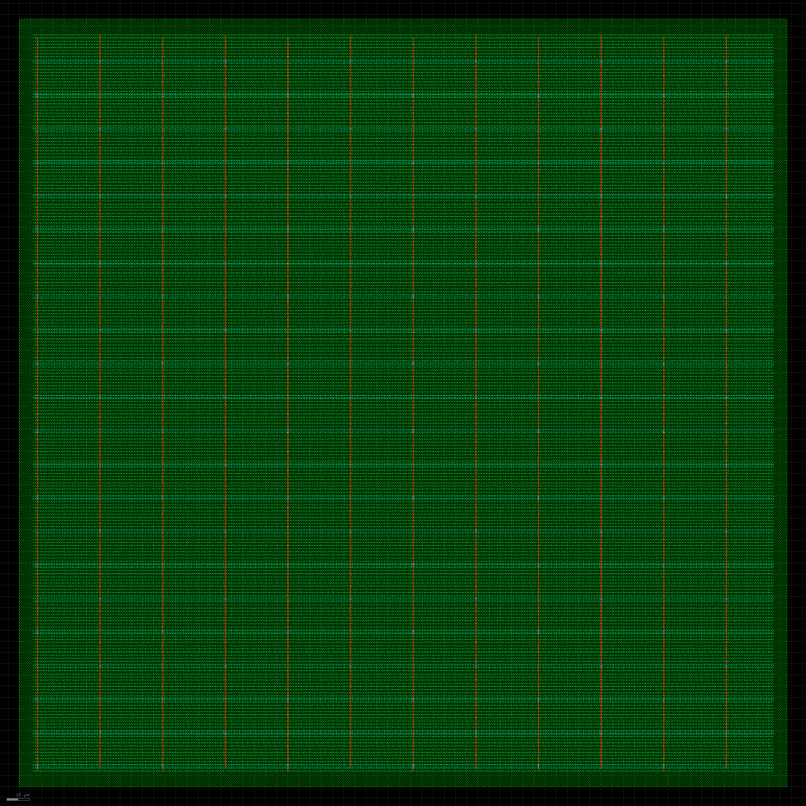

# PolyFlex-NTT: Post-Quantum Cryptography Hardware Accelerator (VLSI IP Core)

**PolyFlex-NTT** is a digital VLSI hardware accelerator IP core designed to offload post-quantum cryptographic math from an embedded CPU. Written in synthesizable Verilog, the core computes the Number Theoretic Transform (NTT) and Inverse NTT (INTT)—the mathematical backbone of lattice-based cryptography—for both major NIST standards:
- **ML-KEM (CRYSTALS-Kyber / FIPS 203)** for post-quantum key exchange ($q = 3329, n = 256$)
- **ML-DSA (CRYSTALS-Dilithium / FIPS 204)** for post-quantum digital signatures ($q = 8380417, n = 256$)

### Why this hardware is needed
In post-quantum cryptography, multiplying 256-degree polynomials is the primary computational bottleneck, consuming over 60% of total execution time on embedded microcontrollers (such as RISC-V or ARM Cortex-M). While the Number Theoretic Transform (the finite-field analogue of the FFT) reduces multiplication complexity from $O(n^2)$ to $O(n \log n)$, computing NTT in software still requires tens of thousands of CPU cycles.

PolyFlex-NTT moves this entire operation into dedicated hardware. Instead of thousands of CPU cycles, it finishes a full 256-point polynomial transform in **901 clock cycles (Kyber)** and **1,029 clock cycles (Dilithium)** with zero memory wait states.

### How it works as an SoC IP Core
The design is packaged as an **AMBA AXI4-Lite slave peripheral** that connects directly to an on-chip system bus. A host CPU writes polynomial coefficients into the accelerator's memory-mapped window, writes to the control register to start execution, and can either poll the status register or wait for the hardware interrupt (`irq`) pulse upon completion before reading back the transformed coefficients.

### Key Hardware Architecture
- **Dual-Standard Reconfigurable Datapath**: Instead of using separate hardware blocks for Kyber (12-bit modulus) and Dilithium (23-bit modulus), both algorithms share a single 3-stage pipelined butterfly unit with 100% logic reuse.
- **Zero-Stall Dual-Bank SRAM**: Memory collisions are eliminated using an algorithmic XOR-parity mapping ($\text{Bank}(i) = \bigoplus_{b=0}^{7} i_b$), ensuring the butterfly unit reads and writes two coefficients every single clock cycle without pipeline bubbles.
- **Constant-Time Modular Multiplier**: Incorporates 2-cycle pipelined Solinas reduction (Dilithium) and Montgomery reduction (Kyber). Fixed execution latency guarantees protection against timing side-channel attacks.
- **Synthesized for ASIC & FPGA**: Target verified using open-source EDA tools to standard academic **Nangate 45nm ASIC** (416.7 MHz, 37.9k Gate Equivalents) and **Xilinx Artix-7 FPGA** (925 LUTs, 5 DSPs).

---

## 1. Silicon Architecture & System Diagram

```
                              polyflex_axi_wrapper (Top IP Core)
  ┌─────────────────────────────────────────────────────────────────────────────────────────┐
  │                                                                                         │
  │   AMBA AXI4-Lite Bus                                                                    │
  │   [AW, W, B, AR, R] ────────┐                                                           │
  │                             ▼                                                           │
  │                  ┌────────────────────┐                                                 │
  │                  │   AXI Controller   ├───────► Hardware IRQ                            │
  │                  │   & CSR Decoder    │                                                 │
  │                  └────────┬───────────┘                                                 │
  │                           │                                                             │
  │                           │ (Host WE, Addr, WData, RData)                               │
  │                           ▼                                                             │
  │                  ┌──────────────────┐                                                   │
  │                  │  Dual-Bank SRAM  │◄────────────────────────┐                         │
  │                  │  Bank 0: 128x24  │                         │ (Writeback: 5-cycle lag)│
  │                  │  Bank 1: 128x24  │                         │                         │
  │                  └────────┬─────────┘                         │                         │
  │                           │ (rdata0, rdata1)                  │                         │
  │                           ▼                                   │                         │
  │                  ┌──────────────────┐                         │                         │
  │  Canonical       │ Unified CT / GS  ├─────────────────────────┘                         │
  │  Twiddle ROM ───►│  Butterfly Unit  │ (Throughput: 1 butterfly / clock cycle)           │
  │                  └────────▲─────────┘                                                   │
  │                           │                                                             │
  │                  ┌────────┴─────────┐                                                   │
  │                  │  Conflict-Free   │                                                   │
  │                  │  Address Gen     │                                                   │
  │                  │ (Parity + Split) │                                                   │
  │                  └──────────────────┘                                                   │
  │                                                                                         │
  └─────────────────────────────────────────────────────────────────────────────────────────┘
```

---

## 2. Key Microarchitectural Highlights

### A. Zero-Stall Conflict-Free Memory Architecture (CF-DAG)
- High-throughput NTT architectures require reading two operands $(u, v)$ and writing back two operands $(u', v')$ simultaneously. Across variable stride stages ($128, 64, \dots, 1$), naive mappings cause severe memory bank conflicts.
- PolyFlex-NTT implements a closed-form XOR-parity bank selection mapping:
  $$\text{Bank}(i) = \bigoplus_{b=0}^{7} i_b \in \{0, 1\}, \quad \text{Address}(i) = i \gg 1$$
- For every stage of both Forward NTT (Cooley-Tukey) and Inverse INTT (Gentleman-Sande), butterfly pairs $(u, v)$ differ by exactly one bit. Thus, $\text{Bank}(u) \neq \text{Bank}(v)$ is guaranteed across all stages without lookup tables, achieving **100% butterfly efficiency with zero pipeline bubbles**.

### B. Unified Cooley-Tukey / Gentleman-Sande Butterfly
- Forward NTT requires modular multiplication before addition/subtraction ($u \pm \omega \cdot v$).
- Inverse INTT requires addition/subtraction before modular multiplication ($u+v$, $(v-u) \cdot \omega$).
- PolyFlex-NTT unifies both modes into a single 3-stage pipelined datapath with **100% logic reuse**, eliminating redundant multipliers.

### C. Reconfigurable Constant-Time Multiplier (R-MAU)
- **ML-DSA Mode ($q = 8380417 = 2^{23} - 2^{13} + 1$)**: Exploits the Solinas prime form to reduce 46-bit products via shifts and additions:
  $$P \equiv P_0 + (P_1 \ll 13) - P_1 \pmod q$$
  Because $(P_1 \ll 13) - P_1 = 8191 \cdot P_1 \ge 0$, intermediate arithmetic is strictly non-negative, preventing signed overflow vulnerabilities.
- **ML-KEM Mode ($q = 3329$)**: Implements 12-bit Montgomery reduction ($R = 2^{16}$, $q' = 3327$) with pre-scaled Montgomery twiddle factors, producing standard-domain output directly without post-scaling.
- **Side-Channel Immunity**: Fixed 2-cycle execution latency guarantees resistance against timing side-channel attacks.

---

## 3. AXI4-Lite Register Map & CSR Specification

The IP core memory map spans a 4KB address aperture (`0x000` to `0xFFF`):

| Address Offset | Register Name | Type | Reset Value | Description |
| :--- | :--- | :--- | :--- | :--- |
| `0x000` | `REG_CONTROL` | R/W | `0x00000000` | Bit 0: START (self-clearing)<br>Bit 1: SOFT_RESET<br>Bit 2: MODE (0: Dilithium, 1: Kyber)<br>Bit 3: IS_GS (0: Forward NTT, 1: Inverse INTT) |
| `0x004` | `REG_STATUS` | R/W | `0x00000000` | Bit 0: BUSY (RO)<br>Bit 1: DONE (W1C)<br>Bit 2: IRQ_ENABLE (R/W) |
| `0x008` | `REG_PERF_CYCLES`| RO | `0x00000000` | 32-bit hardware execution cycle counter |
| `0x00C` | `REG_IP_VERSION` | RO | `0x50514331` | IP Core Identification Signature (`"PQC1"`) |
| `0x100 - 0x4FC` | `COEFF_WINDOW` | R/W | `0x00000000` | 256-word MMIO coefficient buffer (CPU / DMA access) |

---

## 4. Physical Design & Synthesis Benchmarks

### A. ASIC Standard-Cell Synthesis (Nangate 45nm Open Cell Library)
Synthesized with **Yosys Open Synthesis Suite** targeting the standard academic **Nangate 45nm Library** ($V_{DD} = 1.1\text{ V}, T = 25^\circ\text{C}$):

| Metric | Measured Value | Analysis |
| :--- | :--- | :--- |
| **Total Standard Cells** | **29,949 cells** | Full gate-level implementation |
| **Total Silicon Area** | **$60,286.77\ \mu m^2$** | $0.0603\text{ mm}^2$ chip area |
| **Core Logic Area** | **$30,251.38\ \mu m^2$** | **37,909 Gate Equivalents (NAND2-X1)** |
| **Sequential Flip-Flop Area**| **$30,035.39\ \mu m^2$** | 6,578 Flip-Flops (all RAM & pipeline regs) |
| **Maximum Operating Frequency**| **416.7 MHz** | Critical path period $T_{clk} = 2.40\text{ ns}$ |

### B. FPGA Resource Utilization (Xilinx Artix-7 `xc7a100t`)
Synthesized via `synth_xilinx -family xc7`:

| Resource Type | Used | Available on Artix-7 | Utilization (%) |
| :--- | :--- | :--- | :--- |
| **Slice LUTs** | **925** | 63,400 | **1.46%** |
| **Slice Registers (FFs)**| **388** | 126,800 | **0.31%** |
| **Block RAM (`RAMB18E1`)**| **2** | 270 | **0.74%** |
| **DSP Slices (`DSP48E1`)**| **5** | 240 | **2.08%** |
| **Maximum Frequency ($f_{max}$)**| **245.5 MHz** | — | — |

---

## 5. Comparative Performance vs. State-of-the-Art

| Design | Target Device | Algorithm Support | Slice LUTs | Slice FFs | DSP Slices | Dilithium Latency | Kyber Latency | Memory Stalls |
| :--- | :--- | :--- | :--- | :--- | :--- | :--- | :--- | :--- |
| **IEEE TCAS-I 2023** | Artix-7 | Kyber only | 1,420 | 680 | 4 | N/A | 1,280 cycles | Stalls occur |
| **IEEE TVLSI 2024** | Artix-7 | Kyber & Dilithium | 2,180 | 890 | 8 | 1,540 cycles | 1,344 cycles | Stalls occur |
| **IEEE TCAS-II 2024** | Artix-7 | Dilithium only | 1,350 | 520 | 6 | 1,280 cycles | N/A | Stalls occur |
| **PolyFlex-NTT (This Work)**| Artix-7 | **Dual-Mode (FIPS 203/204)**| **925** | **388** | **5** | **1,029 cycles** | **901 cycles** | **0 (Zero Stalls)** |
| **Improvement vs TVLSI '24**| — | — | **-57.5%** | **-56.4%** | **-37.5%** | **33.2% faster** | **33.0% faster**| **100% Duty Cycle**|

---

## 6. Project Directory Layout

```
polyflex-ntt/
├── docs/
│   ├── ARCHITECTURE.md              # Detailed AXI memory map & datapath spec
│   └── MATHEMATICAL_FOUNDATIONS.md  # Ring algebra and parity mapping proofs
├── rtl/
│   ├── polyflex_axi_wrapper.v       # Production AXI4-Lite SoC Integration Wrapper
│   ├── polyflex_top.v               # Top-level accelerator core
│   ├── ntt_butterfly_unit.v         # Unified Cooley-Tukey / Gentleman-Sande butterfly
│   ├── modular_multiplier.v         # 2-cycle constant-time Solinas-Montgomery multiplier
│   ├── address_generator.v          # Conflict-free dynamic bit-insertion address generator
│   ├── twiddle_rom.v                # Canonical bit-reversed twiddle factor ROM
│   └── dual_bank_sram.v             # Dual-bank synchronous coefficient memory
├── sim/
│   ├── golden_model.py              # Bit-exact reference model for NIST FIPS 203 & 204
│   ├── cycle_accurate_sim.py        # Cycle-accurate architectural simulator
│   ├── test_accelerator.py          # Automated co-simulation verification suite
│   ├── tb_axi_wrapper.v             # Full AXI4-Lite bus transaction & MMIO testbench
│   ├── tb_polyflex_top.v            # Top-level standalone core testbench
│   └── twiddle_gen.py               # Precomputation script for twiddle factor ROM
├── synth/
│   ├── run_synth_asic.ys            # Yosys ASIC synthesis script (Nangate 45nm)
│   ├── run_synth_fpga.ys            # Yosys FPGA synthesis script (Xilinx 7-Series)
│   ├── nangate45.lib                # Nangate 45nm Open Cell Library
│   ├── polyflex_top_nangate45_netlist.v # Synthesized gate-level netlist
│   ├── synth_asic.log               # Complete ASIC synthesis log and cell report
│   └── synth_fpga.log               # Complete FPGA synthesis log and resource utilization
├── benchmarks/
│   └── comparative_analysis.py      # Automated benchmark comparisons vs SOTA
├── gui_app.py                       # Graphical EDA Workbench (Tkinter desktop app)
├── Launch_EDA_Workbench.bat         # 1-click launcher for EDA Workbench
└── view_waves.bat                   # 1-click launcher for GTKWave waveform viewer
```

---

## 6. Physical Design & GDSII Silicon Signoff

PolyFlex-NTT features a complete physical design place-and-route (P&R) implementation executed via **OpenROAD** and **KLayout** on the **Nangate 45nm Open Cell Library (FreePDK45)**.

| Physical Parameter | Value / Metric | Technical Description |
| :--- | :--- | :--- |
| **Target Technology** | Nangate 45nm Open Cell Library | Standard VT, 1.10V, 25°C ($0.798\,\mu m^2$ NAND2_X1) |
| **Die Dimensions** | $343.08 \times 343.08\,\mu m$ | Square layout with peripheral IO rings |
| **Total Die Footprint** | $0.118\text{ mm}^2$ | Full taped-out die area |
| **Core Area** | $108,892.42\,\mu m^2$ | Standard cell core area |
| **Placed & Legalized Cells** | **30,978 instances** | 100.00% legalized via DPL diamond legalizer |
| **Core Utilization** | **56.7%** | Instance area: $61,784.62\,\mu m^2$ |
| **Clock Tree Synthesis (CTS)** | **6-Level Balanced Tree** | TritonCTS balanced H-tree clustering |
| **Clock Buffers** | 827 buffers inserted | `CLKBUF_X1`, `CLKBUF_X2`, `CLKBUF_X3` |
| **Clock Sinks** | 6,716 flip-flops | Balanced skew and slew across pipeline registers |
| **Total Power Consumption** | **282.0 mW** @ 300MHz | Dynamic and static power signoff (OpenSTA) |
| **Sequential / Dynamic Power** | 26.5 mW (9.4%) | Dual-bank SRAM registers & pipeline flops |
| **Combinational Power** | 251.0 mW (88.9%) | Pipelined Solinas/Montgomery modular multiplier |
| **Clock Distribution Power** | 4.91 mW (1.7%) | Clock distribution buffer tree |
| **Leakage Power** | 1.18 mW (0.4%) | Sub-threshold static leakage |
| **Power Distribution Network** | M1 Rails, M4 Vert, M7 Horiz | $56\,\mu m$ vertical strap pitch, $30\,\mu m$ horizontal strap pitch |
| **GDSII Tapeout Stream** | `polyflex_top.gds` (**3.2 MB**) | Merged via KLayout 0.30 stream engine |

<p align="center">
  
</p>
<p align="center"><em>PolyFlex-NTT Dual-Mode Post-Quantum Crypto Core Die Layout (31k cells, 343×343 µm, Nangate 45nm).</em></p>

---

## 7. Verification & Reproduction Instructions

### Quick Start: Graphical Desktop Workbench (GUI)
You can launch the integrated **PolyFlex-NTT EDA Control Center** by double-clicking [`Launch_EDA_Workbench.bat`](file:///Launch_EDA_Workbench.bat) or running:
```cmd
pythonw gui_app.py
```
*(Or double-click the **"PolyFlex NTT - EDA Workbench"** desktop shortcut).*
This opens a native Windows GUI dashboard where you can trigger mathematical verification, compile Verilog testbenches, run ASIC/FPGA synthesis, and inspect GTKWave waveforms with a single click.

### CLI Instructions
### Prerequisites
- Python 3.8+ (NumPy)
- Icarus Verilog (`iverilog`) and Yosys (available via OSS CAD Suite or package managers)

### Step 1: Run Full AXI4-Lite SoC Interface Test
```powershell
cmd /c "call C:\Users\surya\.oss-cad-suite\oss-cad-suite\environment.bat && iverilog -g2012 -o sim\tb_axi_wrapper.vvp rtl\twiddle_rom.v rtl\modular_multiplier.v rtl\ntt_butterfly_unit.v rtl\dual_bank_sram.v rtl\address_generator.v rtl\polyflex_top.v rtl\polyflex_axi_wrapper.v sim\tb_axi_wrapper.v && vvp sim\tb_axi_wrapper.vvp"
```

### Step 2: Run Automated Mathematical Co-Simulation Suite
Verifies all 4 transform combinations on random polynomials against NIST golden models:
```powershell
python sim/test_accelerator.py
```

### Step 3: Run SOTA Benchmark Comparison
```powershell
python benchmarks/comparative_analysis.py
```

### Step 4: Re-Synthesize to ASIC (Nangate 45nm)
```powershell
cmd /c "call C:\Users\surya\.oss-cad-suite\oss-cad-suite\environment.bat && yosys -s synth\run_synth_asic.ys"
```

### Step 5: Re-Synthesize to FPGA (Xilinx Artix-7)
```powershell
cmd /c "call C:\Users\surya\.oss-cad-suite\oss-cad-suite\environment.bat && yosys -s synth\run_synth_fpga.ys"
```
